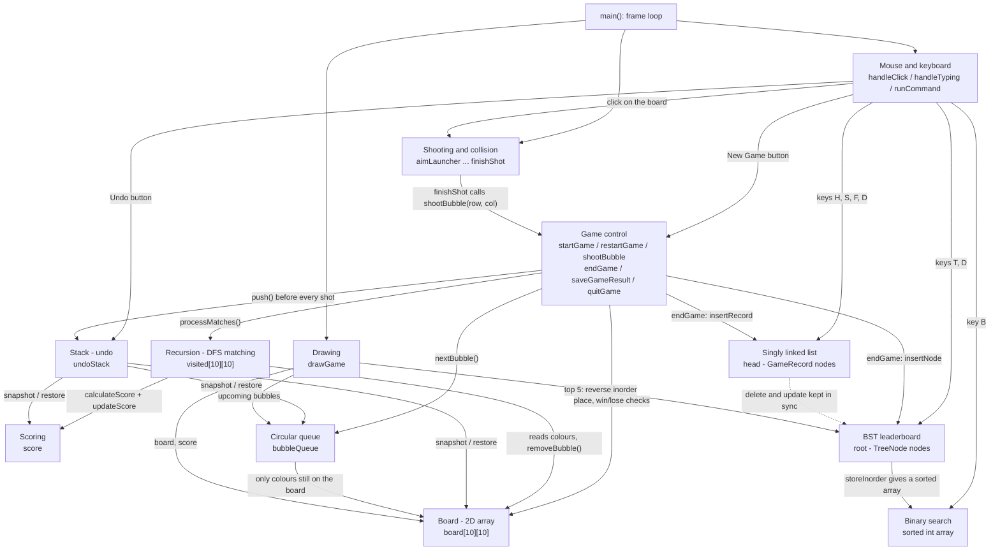
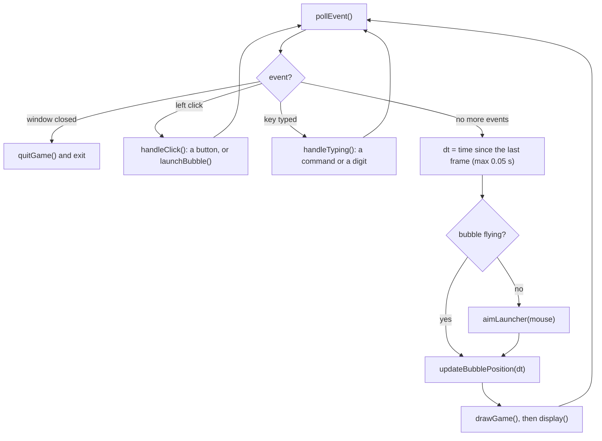
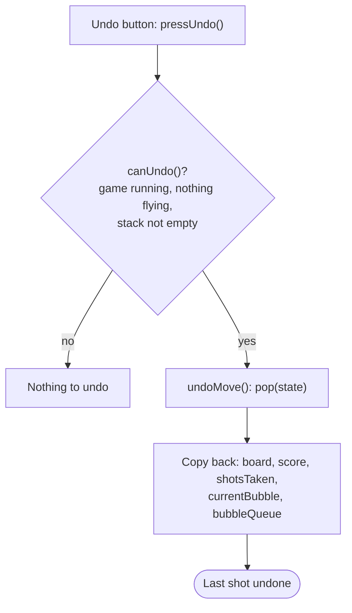

# Bubble Shooter: Program Overview

How the project works: every class, every function, how they connect, and what happens step by step.

> **About the diagrams:** blocks marked `mermaid` render as pictures on GitHub, in VS Code with the
> *Markdown Preview Mermaid Support* extension, or when pasted into <https://mermaid.live>.
> The most important flows are also drawn in plain text, so they show up everywhere, including in print.

---

## 1. What the program is

### 1.1 Files

```
DSA Project/
|-- README.md                 short intro for GitHub: build, run, controls
|-- code/
|   |-- bubbleshooter.cpp     the whole program - ONE file
|   |-- build.bat             builds it (double-click)
|   '-- bubbleshooter.exe     the game, made by build.bat (not uploaded to GitHub)
'-- docs/
    |-- PROGRAM_OVERVIEW.md   this file
    |-- CODE_REVIEW.md        the review of the original code
    '-- bubbleshooter.cpp.bak your original code, from before the review
```

**Build and run:** double-click `code/build.bat`, then run `code/bubbleshooter.exe`. The exe is linked statically, so it runs on its own, even on a PC without MSYS2 or SFML.

**Two windows open:**
- **Game window (SFML):** the board, aiming, score and buttons.
- **Text window:** the data structures print here when you press the keys in 1.3 (history, sorting, searching, traversals). Closing it also closes the game.

### 1.2 Rules

- The board is 10 × 10. The top 4 rows start filled with random colours.
- You aim with the mouse and click. The bubble flies, bounces off the side walls, and sticks when it touches the ceiling or another bubble.
- A group of **3 or more** connected bubbles of the same colour pops: **10 points per bubble**.
- **Win:** the board is empty. **Lose:** any bubble reaches the danger zone (rows 8 and 9).
- New bubbles only come in colours that are **still on the board**, so a game can always be finished.
- Every finished game is saved in a **linked list** (history) and a **BST** (leaderboard). These records are kept **in memory only**, so they are gone when you close the game. Play a few games before showing the keys in a demo.

### 1.3 Controls

| Control | What it does | Data structure it shows |
|---|---|---|
| Move the mouse | Aim | – |
| Left click on the board | Shoot | 2D array, recursion, queue, stack, scoring |
| **New Game** button | Start again | everything is reset |
| **Undo** button | Take back the last shot | **Stack** |
| **H** | Print the game history | **Linked list** traversal |
| **S** | Sort the history by score | **Merge sort** on the linked list |
| **F**, a number, Enter | Find a game by its ID | **Linear search** |
| **D**, a number, Enter | Delete a game | Linked-list delete + **BST delete** |
| **T** | Leaderboard: inorder, preorder, postorder, height, lowest and highest | **BST** |
| **B**, a number, Enter | Search for a score | BST → sorted array → **binary search** |

- Keys are pressed **in the game window**, and numbers are typed there too. The question appears in yellow under the buttons. **Backspace** deletes a digit and **Esc** cancels. The game keeps running while you type.
- The side panel always shows the **upcoming bubbles** (the circular queue) and the **top 5 scores** (a reverse inorder traversal of the BST).

```
 +---------------------------------------+   +-----------------------------+
 |                                       |   | BUBBLE SHOOTER              |
 |   board: 10 x 10 cells, 50 px each    |   | Score / Shots               |
 |                                       |   | Bubbles left / Best         |
 |                                       |   | Upcoming: o o o o o         |  <- circular queue
 |                                       |   | [ New Game ]                |
 |                                       |   | [   Undo   ]                |  <- stack (grey when empty)
 |                                       |   | status, or "Find game ID: _"|
 |---- danger line (row 8) --------------|   | Top scores (BST)            |  <- reverse inorder
 |                                       |   | Keys: H S F D T B           |
 +---------------------------------------+   +-----------------------------+
                  ( O )  launcher                     window: 790 x 650 pixels
```

**Colour codes**

| Value | 0 | 1 | 2 | 3 | 4 | 5 |
|---|---|---|---|---|---|---|
| Meaning | empty | Red | Blue | Green | Yellow | Purple |

---

## 2. The big picture

### 2.1 Map of the file

`bubbleshooter.cpp` has **two parts**:
- **Part 1** is the DSA project itself. It has no graphics and would work with any interface.
- **Part 2** is the window. It only calls Part 1.

```
 bubbleshooter.cpp (line numbers)
 +------------------------------------------------------------------------------+
 |    1  header comment, #includes, using namespace std                         |
 +------------------------------------------------------------------------------+
 | PART 1 - GAME LOGIC AND DATA STRUCTURES (no graphics)                        |
 |   22  CONSTANTS & GLOBALS     board[10][10], score, gameActive ...           |
 |   40  QUEUE                   circular queue of upcoming bubbles             |
 |  119  STACK                   undo snapshots                                 |
 |  192  BOARD                   2D array operations                            |
 |  251  SCORING                 10 points per bubble                           |
 |  256  RECURSION               DFS that finds a matching group                |
 |  314  WIN / LOSE                                                             |
 |  326  SINGLY LINKED LIST      game history + merge sort                      |
 |  451  BST                     leaderboard                                    |
 |  577  SEARCHING               binary search                                  |
 |  601  RECORDS + LEADERBOARD   keeps the list and the BST in sync             |
 |  625  GAME CONTROL            start / restart / shoot / end / quit           |
 +------------------------------------------------------------------------------+
 | PART 2 - THE WINDOW (SFML) - only calls Part 1                               |
 |  693  LAYOUT                  sizes and positions in pixels                  |
 |  710  SHOOTING STATE          flying bubble, buttons, status text            |
 |  740  SHOOTING & COLLISION    aim, fly, bounce, hit, snap (sheet Q5)         |
 |  854  MOUSE & KEYBOARD        buttons, clicks, keys H S F D T B              |
 |  977  DRAWING                 draws everything, 60 times a second            |
 | 1153  main()                  opens the window and runs the frame loop       |
 +------------------------------------------------------------------------------+
```

### 2.2 How the parts connect



### 2.3 Who reads and writes each global

**Part 1 (game state)**

| Global | Type | Written by | Read by |
|---|---|---|---|
| `board[ROWS][COLS]` | `int` 2D array | `initializeBoard`, `placeBubble`, `removeBubble`, `undoMove` | nearly everything: matching, `push`, `checkWin/Lose`, colour choice, collision, drawing |
| `visited[ROWS][COLS]` | `bool` 2D array | `resetVisited`, `checkConnected` | `isMatchingColor` |
| `matchRows[] / matchCols[] / matchCount` | `int` arrays + counter | `findMatches`, `checkConnected` | `removeMatches`, `countMatches` |
| `score` | `int` | `resetScore`, `updateScore`, `undoMove` | `push`, `saveGameResult`, `finishShot`, drawing |
| `shotsTaken` | `int` | `startGame`, `shootBubble`, `undoMove` | `push`, `saveGameResult`, drawing |
| `currentBubble` | `int` (colour) | `nextBubble`, `undoMove` | `shootBubble`, `push`, `launchBubble`, drawing |
| `bubbleQueue` | `Queue` | `initializeQueue`, `enqueue`, `dequeue`, `nextBubble`, `undoMove` | `push`, `getFront`, drawing |
| `undoStack` | `Stack` | `initializeStack`, `push`, `pop` | `undoMove`, `peek`, `canUndo` |
| `gameActive` | `bool` | `startGame`, `endGame` | `shootBubble`, `undoMove`, `launchBubble`, `newGame`, drawing |
| `nextGameID` | `int` | `saveGameResult` (++) | `saveGameResult`, `finishShot` |
| `head` | `GameRecord*` | `insertRecord`, `deleteRecord`, `sortRecords`, `clearRecords` | all list functions |
| `root` | `TreeNode*` | `saveGameResult`, `updateRecord`, key D, `quitGame` | `getHighScore`, keys T and B, top-5 list |

**Part 2 (window state)**

| Global | Purpose |
|---|---|
| `shot` (`MovingBubble`) | The bubble in flight: position, velocity, colour, `isMoving` |
| `aimX, aimY` | Unit vector from the launcher towards the mouse |
| `statusText` | Yellow message under the buttons ("Popped 5 bubbles! +50") |
| `gameOver, lastGameWon, lastGameID` | What the win / lose message shows |
| `asking, typedNumber` | While you type a number: which key asked (`'F'`, `'D'`, `'B'`) and the digits so far |

---

## 3. Data structures at a glance

| Structure | Variable | What it stores | Key operations | Cost |
|---|---|---|---|---|
| 2D array | `board` | colour of every cell | place / remove / check a cell | O(1) per cell, O(R·C) to scan |
| Recursion (DFS) + `visited` | `visited`, `matchRows/Cols` | the group of same-colour bubbles | `checkConnected` | O(R·C) |
| Circular queue | `bubbleQueue` | the next 5 bubble colours | enqueue / dequeue | O(1) |
| Stack (array) | `undoStack` | up to 20 full game snapshots | push / pop | O(R·C) per snapshot copy |
| Singly linked list | `head` | one node per finished game | insert at tail, search, delete, merge sort | O(n), sort O(n log n) |
| Binary search tree | `root` | `(score, gameID)` per finished game | insert / search / delete / min / max | O(h): about log n, worst case n |
| Binary search | temporary `int[]` | the sorted scores taken from the BST | `binarySearch` | O(log n) |

---

## 4. Classes and structs

All of them are plain data holders (all members `public`, no methods), which is the "structures and ordinary functions" style the sheet recommends.

### `class Queue` (line 41)

```cpp
int bubbles[QUEUE_SIZE];   // the circular array (size 10)
int front = 0;             // index of the next colour to come out
int rear  = -1;            // index of the last colour that went in
int count = 0;             // how many colours are stored
```

`count` is what tells "empty" (0) apart from "full" (10). Without it, `front == rear` would be ambiguous. Indices wrap around with `% QUEUE_SIZE`.

### `class GameState` (line 120)

One **complete snapshot** of everything a shot can change:

```cpp
int savedBoard[ROWS][COLS];
int savedScore, savedShots, savedCurrentBubble;
Queue savedQueue;          // the whole queue, so Undo also restores the upcoming bubbles
```

That is 100 + 3 + 13 integers, about 464 bytes per snapshot.

### `class Stack` (line 128)

```cpp
GameState states[STACK_SIZE];  // 20 snapshots, about 9 KB
int top = -1;                  // -1 means empty
```

### `class GameRecord` (line 327): linked-list node

```cpp
int gameID, score, shots;  bool won;  GameRecord *next;
```

### `class TreeNode` (line 452): BST node

```cpp
int score, gameID;  TreeNode *left, *right;
```

The BST is ordered by the **pair** `(score, gameID)` (see `comesBefore`), so two games with the same score are still two different keys.

### `struct MovingBubble` (line 711): the bubble in flight (exactly the sheet's struct)

```cpp
float x, y;  float velocityX, velocityY;  int color;  bool isMoving;
```

### `struct Button` (line 729)

```cpp
float x, y, width, height;  string label;     // newGameButton, undoButton
```

---

## 5. Function reference

### 5.1 Queue: upcoming bubbles

| Function | What it does | How it works | Time |
|---|---|---|---|
| `isQueueEmpty()` | Is the queue empty? | `count == 0` | O(1) |
| `isQueueFull()` | Is the queue full? | `count == QUEUE_SIZE` | O(1) |
| `enqueue(color)` | Add a colour at the back | If not full: `rear = (rear+1) % SIZE`, store, `count++` | O(1) |
| `dequeue()` | Remove the colour at the front | If not empty: read `bubbles[front]`, `front = (front+1) % SIZE`, `count--`. Returns −1 when empty | O(1) |
| `getFront()` | Peek at the next colour | `bubbles[front]` (−1 if empty) | O(1) |
| `randomColor()` | Any colour 1–5 | `rand() % COLORS + 1`. Only used to fill the starting board | O(1) |
| `colorOnBoard(color)` | Is this colour still on the board? | Scans the 2D array | O(R·C) |
| `generateRandomBubble()` | Random colour **still on the board** | Collects the colours for which `colorOnBoard` is true and picks one at random (any colour if the board is empty). With one blue bubble left, you only get blue | O(COLORS·R·C) |
| `initializeQueue()` | Fresh queue with 5 colours | Resets `front/rear/count`, then calls `enqueue(generateRandomBubble())` 5 times | O(1) |
| `nextBubble()` | Load the next bubble | Replaces any queued colour that has since left the board, then `currentBubble = dequeue()`, then `enqueue(...)` so 5 are always waiting | O(R·C) |

**Wrap-around in action.** Each shot does one `dequeue` and one `enqueue`, so the queue slides around the array:

| Moment | front | rear | count | Slots in use |
|---|---|---|---|---|
| after `initializeQueue()` | 0 | 4 | 5 | 0–4 |
| after `startGame()` (one `nextBubble`) | 1 | 5 | 5 | 1–5 |
| after shot 4 | 5 | 9 | 5 | 5–9 |
| after shot 5 | 6 | **0** | 5 | 6–9 and 0 (**rear wrapped**) |
| after shot 9 | **0** | 4 | 5 | 0–4 (**front wrapped**) |

### 5.2 Stack: undo

| Function | What it does | How it works | Time |
|---|---|---|---|
| `initializeStack()` | Empty the undo history | `top = -1` | O(1) |
| `isStackEmpty()` / `isStackFull()` | Check the state | `top == -1` / `top == STACK_SIZE-1` | O(1) |
| `push()` | Save the current game | If full, shift every state down one place (the oldest is dropped). Then `top++` and copy the board, score, shots, current bubble and queue into `states[top]` | O(R·C) |
| `pop(state)` | Take the newest snapshot | Returns `false` if empty; otherwise copies `states[top]` out and `top--` | O(R·C) |
| `peek(state)` | Look without removing | Same as `pop` without the `top--` | O(R·C) |
| `undoMove()` | Undo the last shot | Only during an active game. `pop()`, then copy every saved field back into the globals | O(R·C) |

**When does it push?** `shootBubble()` calls `push()` only **after** the shot has been validated and **before** the board changes. Each stack entry is therefore "the game exactly as it was before shot *k*":

```
shot 1 -> push(S0)        stack: [S0]
shot 2 -> push(S1)        stack: [S0, S1]
shot 3 -> push(S2)        stack: [S0, S1, S2]
Undo   -> pop() = S2      game is back to "before shot 3"   stack: [S0, S1]
```

- **When it is full (20 entries):** `states[1..19]` move to `states[0..18]` and the new snapshot goes in `states[19]`. The oldest move is forgotten, so the newest 20 can always be undone.
- **When the game ends:** `endGame()` empties the stack, so a finished (and already saved) game can't be undone back to life.

### 5.3 Board: 2D array

| Function | What it does | How it works | Time |
|---|---|---|---|
| `isValidCell(r,c)` | Is (r,c) on the board? | `0 ≤ r < ROWS` and `0 ≤ c < COLS` | O(1) |
| `isEmpty(r,c)` | Is the cell on the board **and** empty? | `isValidCell && board[r][c] == 0` | O(1) |
| `initializeBoard()` | New starting board | Set all cells to 0, then fill rows 0–3 with `randomColor()` | O(R·C) |
| `resetBoard()` | Same as above | Calls `initializeBoard()` | O(R·C) |
| `countBubbles()` | How many bubbles are left | Counts the non-zero cells (shown as "Bubbles left") | O(R·C) |
| `placeBubble(r,c,color)` | Put a bubble down | Writes only if the cell is valid and empty | O(1) |
| `removeBubble(r,c)` | Clear a cell | Sets it to 0 if valid | O(1) |
| `isBoardEmpty()` | Is the board empty (win)? | Stops at the first non-zero cell | O(R·C) |
| `isAttached(r,c)` | Could a bubble stop here? | True if `r == 0` (ceiling), or there is a bubble **above** or **left/right**. A bubble only *below* doesn't count, because the flying bubble would have hit it first | O(1) |

```
isAttached example         A = allowed, x = not allowed
row 0:  1 2 . . .          (0,2) A  row 0 always touches the ceiling
row 1:  . 2 . . .          (1,0) A  bubble above it (the 1)
row 2:  . . . . .          (1,2) A  bubble beside it (the 2 at (1,1)), nothing above
                           (2,1) A  bubble above it
                           (2,0) x  nothing above or beside
```

### 5.4 Scoring

| Function | What it does | How it works |
|---|---|---|
| `calculateScore(n)` | Points for popping n bubbles | `n * 10` (3 → 30, 4 → 40, 5 → 50, 6 → 60) |
| `updateScore(points)` | Add points | `score += points` |
| `resetScore()` | New game | `score = 0` |
| `getHighScore()` | Best score ever recorded | Right-most BST node: `findMax(root)->score`, or 0 if the tree is empty (shown as "Best") |

### 5.5 Recursion: finding matching groups

| Function | What it does | How it works | Time |
|---|---|---|---|
| `resetVisited()` | Clear the visited marks | Sets every `visited[i][j] = false` | O(R·C) |
| `isMatchingColor(r,c,color)` | Should the DFS enter this cell? | The cell must be valid, **not visited**, `color != 0` and the same colour | O(1) |
| `checkConnected(r,c,color)` | **Recursive DFS** | 1) If the cell doesn't match, return (base case). 2) Mark it visited and record it in `matchRows/Cols`. 3) Recurse up, down, left and right | O(size of group) |
| `findMatches(r,c)` | Size of the group containing (r,c) | `resetVisited()`, `matchCount = 0`, then `checkConnected(r, c, board[r][c])` | O(R·C) |
| `countMatches()` | Size of the last group found | `return matchCount` | O(1) |
| `removeMatches()` | Pop the group if it is big enough | If `matchCount ≥ 3`, `removeBubble` every recorded cell. Returns how many were popped (0 otherwise) | O(group) |
| `processMatches(r,c)` | The whole match step | `findMatches` → `removeMatches` → if anything popped, `updateScore(calculateScore(removed))` | O(R·C) |

- **Why `visited`?** Without it, cell A calls B and B calls A straight back, forever (stack overflow). Marking a cell **before** recursing guarantees each cell is entered once.
- **Why record first and remove later?** Removing cells during the search would change the board while the DFS is still reading it. The sheet's *Important* box asks for exactly this order.

**Worked example.** A colour-2 bubble lands at (2,1):

```
        col 0 1 2
row 0:      2 2 1
row 1:      . 2 3
row 2:      . 2 .     <- just placed

checkConnected(2,1)                 OK  #1
+-- up    checkConnected(1,1)       OK  #2
|   +-- up    checkConnected(0,1)   OK  #3
|   |   +-- up    (-1,1)  invalid           x
|   |   +-- down  (1,1)   already visited   x
|   |   +-- left  checkConnected(0,0) OK #4  (its 4 neighbours all rejected)
|   |   +-- right (0,2)   colour 1          x
|   +-- down  (2,1)   already visited       x
|   +-- left  (1,0)   empty                 x
|   +-- right (1,2)   colour 3              x
+-- down  (3,1)   empty                     x
+-- left  (2,0)   empty                     x
+-- right (2,2)   empty                     x

matchCount = 4  ->  4 >= 3  ->  4 bubbles removed, +40 points
```

### 5.6 Win / lose

| Function | Rule |
|---|---|
| `checkWin()` | `isBoardEmpty()` |
| `checkLose()` | Any bubble in rows `DANGER_ROW` (8) to 9 |

### 5.7 Singly linked list: game history

| Function | What it does | How it works | Time |
|---|---|---|---|
| `insertRecord(id,score,shots,won)` | Add a finished game | `new` node; if the list is empty it becomes `head`, otherwise walk to the last node and link it there (keeps chronological order) | O(n) |
| `displayRecords()` | Print the history (key **H**) | Walk from `head` to `NULL` | O(n) |
| `searchRecord(id)` | **Linear search** by ID (key **F**) | Walk and compare `gameID`; returns the node or `NULL` | O(n) |
| `deleteRecord(id)` | Remove a game (key **D**) | Head case: move `head`. Otherwise stop at the node **before** the target, re-link around it, and `delete` it | O(n) |
| `countRecords()` | Number of games | Walk and count (printed by key **H**) | O(n) |
| `getMiddle(start)` | Middle node, for splitting | `slow` moves 1 step and `fast` 2 steps; when `fast` reaches the end, `slow` is at the middle | O(n) |
| `mergeLists(a,b)` | Merge two sorted lists | Recursively pick the node with the higher score (`>=` keeps it stable) and link it in front of the merged rest | O(n) |
| `mergeSort(start)` | **Merge sort** the list | Split at `getMiddle`, sort each half recursively, then `mergeLists` | O(n log n) |
| `sortRecords()` | Sort the history by score, high to low (key **S**) | `head = mergeSort(head)` | O(n log n) |
| `updateRecord(id,newScore)` | Change a game's score | Find it; **remove the old key from the BST**, change the score, insert the new key | O(n + h) |
| `clearRecords()` | Free the whole list | Delete nodes one at a time from `head` | O(n) |

**Merge sort example.** Scores `30 → 50 → 10 → 40`:

```
split:   [30 50]          [10 40]
split:   [30] [50]        [10] [40]
merge:   [50 30]          [40 10]         (higher score first)
merge:   [50 40 30 10]
```

Only the `next` pointers change. No scores are swapped between nodes.

### 5.8 Binary search tree: leaderboard

| Function | What it does | How it works | Time |
|---|---|---|---|
| `comesBefore(s1,id1,s2,id2)` | Key comparison | Compare scores; if they are equal, compare IDs | O(1) |
| `insertNode(node,score,id)` | Insert a game | Recursive: smaller key goes left, larger goes right; a new node is created at `NULL` | O(h) |
| `searchNode(node,score,id)` | Find a game | Same path as insert; returns the node or `NULL` | O(h) |
| `findMin(node)` / `findMax(node)` | Lowest / highest score | Keep going left / right | O(h) |
| `inorder(node)` | **Left, Root, Right** | Prints in ascending order (key **T**) | O(n) |
| `preorder(node)` | **Root, Left, Right** | Prints scores (key **T**) | O(n) |
| `postorder(node)` | **Left, Right, Root** | Prints scores (key **T**) | O(n) |
| `deleteNode(node,score,id)` | Remove a game (key **D**) | **Leaf:** delete it. **One child:** replace it with that child. **Two children:** copy the inorder successor (min of the right subtree) into it, then delete that successor | O(h) |
| `height(node)` | Tree height (key **T**) | `1 + max(height(left), height(right))`; empty = 0 (counts **nodes**) | O(n) |
| `countNodes(node)` | Number of nodes | `1 + count(left) + count(right)` | O(n) |
| `clearTree(node)` | Free the whole tree | **Postorder**: children are deleted before the parent | O(n) |

**Example.** Games inserted in the order `(40,#1) (20,#2) (60,#3) (40,#4) (10,#5)`:

```
              (40,#1)
             /       \
       (20,#2)       (60,#3)
       /             /
  (10,#5)       (40,#4)        <- same score as #1, higher ID -> goes right, then left of 60

inorder  : 10 20 40 40 60   (ascending)
findMax  : (60,#3)          height: 3

delete examples (each one starts from the tree above):
  delete (10,#5) -> leaf case: simply removed
  delete (20,#2) -> one-child case: (10,#5) takes its place
  delete (40,#1) -> two-children case: successor = min of the right subtree = (40,#4)
                    is copied into the root, then (40,#4) is deleted from the right subtree
```

### 5.9 Searching

| Function | What it does | How it works | Time |
|---|---|---|---|
| `storeInorder(node,arr,index)` | BST → sorted array | An inorder traversal writes each score to `arr[index++]`; the inorder of a BST is always sorted | O(n) |
| `binarySearch(arr,size,key)` | **Binary search** (key **B**) | `low = 0`, `high = size-1`; check `mid`; if `arr[mid] < key` search right, else search left; stop when `low > high` | O(log n) |

```
arr = [10, 20, 40, 40, 60], key = 50
low=0 high=4 mid=2 -> 40 < 50 -> low=3
low=3 high=4 mid=3 -> 40 < 50 -> low=4
low=4 high=4 mid=4 -> 60 > 50 -> high=3
low > high -> not found (-1)
```

### 5.10 Game control

| Function | What it does |
|---|---|
| `startGame()` | `initializeBoard` → `initializeQueue` → `initializeStack` → `resetScore` → `shotsTaken = 0` → `nextBubble` → `gameActive = true` |
| `restartGame()` | Prints that the current game is abandoned (not saved), then `startGame()` |
| `shootBubble(r,c)` | Places a bubble in a cell. Validate (active game, valid empty cell, `isAttached`) → `push` → `placeBubble` → `shotsTaken++` → `processMatches` → `nextBubble`. Returns `false` and changes nothing for an invalid cell |
| `endGame(won)` | `gameActive = false` → `saveGameResult(won)` → `initializeStack()` |
| `saveGameResult(won)` | `id = nextGameID++` → `insertRecord(...)` (list) → `insertNode(...)` (BST) → prints the ID, final score and best score |
| `quitGame()` | `clearRecords()` + `clearTree(root)` + `root = NULL` (frees all memory) |

### 5.11 Window: shooting and collision (sheet Question 5)

| Function | Sheet name | What it does |
|---|---|---|
| `aimLauncher(mouse)` | aimLauncher | Angle from the launcher to the mouse with `atan2`, **clamped** to about 9°–171° above the horizontal so a shot can never go downwards. `cos` and `sin` of the angle give the unit direction |
| `launchBubble()` | shootBubble | If a game is running and no bubble is flying: start at the launcher with velocity = direction × 900 px/s. A second click while a bubble is flying is ignored (sheet rule). It has a different name because `shootBubble(row, col)` already exists in Part 1 |
| `updateBubblePosition(dt)` | updateBubblePosition | Moves the bubble by velocity × dt, in steps of at most 4 px. After every step: `checkWallCollision`, then `checkCollision` |
| `checkWallCollision()` | checkWallCollision | If the bubble has passed the left or right wall, put it back on the wall and flip the sign of `velocityX` (the bounce) |
| `checkCollision()` | checkCollision | True if the bubble reached the top wall, or its centre is closer than 0.85 × cell to any bubble on the board |
| `findNearestCell(row, col)` | findNearestCell | Among the **empty cells that pass `isAttached`**, picks the one whose centre is closest to the bubble |
| `snapBubbleToGrid()` | snapBubbleToGrid | Stops the bubble and passes the nearest cell to `finishShot` |
| `finishShot(row, col)` | finishShot | Calls Part 1's `shootBubble(row, col)` (undo snapshot, place, recursive match, score, next bubble). Then sets "Popped N bubbles" (N from `countMatches()`) and runs `checkWin` / `checkLose` → `endGame` |
| `cellCenter(row, col)` | – | Pixel centre of a cell: `x = 20 + col*50 + 25`, `y = 20 + row*50 + 25`. This is the **single coordinate-to-cell mapping** the sheet asks you to decide on |

### 5.12 Window: mouse and keyboard

| Function | What it does |
|---|---|
| `handleClick(p)` | New Game button → `newGame()`. Undo button → `pressUndo()`. Anywhere on the board → `launchBubble()` |
| `newGame()` | Stops a flying bubble, then `restartGame()` (game running) or `startGame()` |
| `pressUndo()` / `canUndo()` | Undo only works while a game is running, no bubble is flying and the stack isn't empty |
| `handleTyping(c)` | Called for every key typed in the game window. **H, S, T** run straight away. **F, D, B** set `asking` and wait for digits. Then digits are added to `typedNumber`, **Backspace** removes one, **Enter** runs the command with `stoi(typedNumber)`, and **Esc** cancels. Upper or lower case both work; other keys are ignored |
| `runCommand(key, number)` | Does the work of each key and prints to the text window: H → `displayRecords` + `countRecords`; S → `sortRecords`; F → `searchRecord`; D → `deleteNode` (BST) + `deleteRecord` (list); T → `inorder`, `preorder`, `postorder`, `height`, `findMin`, `findMax`; B → `countNodes`, `storeInorder`, `binarySearch` |
| `collectTopScores(...)` | **Reverse inorder** (right, root, left) of the BST, stopping after 5, so the panel lists the highest scores first |

### 5.13 Window: drawing and main

| Function | What it does |
|---|---|
| `drawGame(target, font, mouse)` | Draws everything: board, danger line, bubbles, aim dots, launcher, flying bubble, side panel, buttons, the yellow status or typing question, the top-5 list, key help, and the win / lose message |
| `bubbleColor`, `drawBubble`, `drawText`, `drawButton` | Small drawing helpers |
| `loadFont(font)` | SFML has no built-in font. It uses `font.ttf` next to the exe if there is one, otherwise Arial, Segoe UI, Tahoma or Calibri from Windows. Without any font the game still works, just with no text |
| `main()` | Opens the window, prints the welcome text, `startGame()`, then runs the frame loop (6.1). On close: `quitGame()` |

---

## 6. Flowcharts

### 6.1 One frame (60 per second)



### 6.2 One shot (sheet Question 11)

```
 mouse moves -> aimLauncher(): direction = (cos a, sin a), angle a clamped to 9..171 degrees
 left click  -> launchBubble(): position = launcher, velocity = direction * 900 px/s
 each frame  -> updateBubblePosition(dt), in steps of at most 4 px:
                  move -> checkWallCollision() (bounce) -> checkCollision()?
                                                             |
                                no: keep flying <------------+------------> yes:
                                                                   snapBubbleToGrid()
                                                                     findNearestCell()   closest empty + attached cell
                                                                     finishShot(row, col)
                                                                       |
            +----------------------------------------------------------+
            v
 [1] shootBubble(row, col)          PART 1 from here on
 [2] push()                         save board + score + shots + current bubble + queue   (STACK)
 [3] placeBubble(); shotsTaken++                                                           (2D ARRAY)
 [4] processMatches(row, col)
        findMatches -> resetVisited -> checkConnected (recursive DFS)                      (RECURSION)
        removeMatches   only if the group has 3 or more
        updateScore(calculateScore(removed))   10 points per bubble                        (SCORING)
 [5] nextBubble()                   dequeue -> currentBubble, enqueue a colour on the board (QUEUE)
 [6] back in finishShot():
        checkWin()  (board empty)      -> "YOU WIN!"   -> endGame(true)
        checkLose() (bubble in row 8+) -> "GAME OVER"  -> endGame(false)
        otherwise keep playing
```

### 6.3 End of a game

```
 endGame(won)
   |-- gameActive = false
   |-- saveGameResult(won)
   |      |-- id = nextGameID++
   |      |-- insertRecord(id, score, shotsTaken, won)   -> appended to the LINKED LIST
   |      |-- root = insertNode(root, score, id)         -> placed in the BST
   |      '-- print best score = getHighScore() = findMax(root)
   '-- initializeStack()                                 -> undo history wiped (the game is final)
```

### 6.4 Undo



### 6.5 The keys H S F D T B

```
 key typed in the game window -> handleTyping(c)
   |
   |-- H, S or T -> runCommand(key, 0) straight away
   |
   '-- F, D or B -> asking = key, the panel shows "Find game ID: _" (or Delete / Search score)
                      digits      -> typedNumber += digit
                      Backspace   -> remove the last digit
                      Esc         -> cancel
                      Enter       -> runCommand(asking, stoi(typedNumber))

 runCommand(key, number)                                     output -> text window
   H  displayRecords(), countRecords()                       linked list traversal
   S  sortRecords() = mergeSort(head), displayRecords()      merge sort
   F  searchRecord(number)                                   linear search
   D  record = searchRecord(number)
      root = deleteNode(root, record->score, number)         BST delete first (it needs the score)
      deleteRecord(number)                                   then the linked-list delete
   T  inorder, preorder, postorder, height, findMin, findMax BST
   B  total = countNodes(root); scores = new int[total]
      storeInorder(root, scores, i)                          BST inorder -> ascending array
      binarySearch(scores, total, number)                    -> index or -1
      delete[] scores
```

---

## 7. Why it is built this way

- **One file, two parts.** Part 1 (the DSA) has no graphics at all, and Part 2 (the window) only calls Part 1. This follows the sheet's advice to "keep game logic separate from SFML drawing", without needing several files.
- **Steps of at most 4 px.** At 900 px/s a bubble moves about 15 px per frame. Checking every 4 px means it can never skip "through" another bubble.
- **A clamped aim.** A shot aimed downwards would never hit anything.
- **Only empty, attached cells are candidates.** The landing cell always passes `shootBubble`'s own checks, so a bubble can never float in empty space.
- **`HIT_DISTANCE` = 0.85 × cell.** Neighbouring cells are exactly one cell apart, so a bubble flying straight up an empty column slips between its neighbours without touching them.
- **Only colours that are still on the board.** Otherwise, with one blue bubble left, you could keep getting the other 4 colours and the game would never end.
- **Numbers are typed in the game window.** Reading with `cin` would freeze the game window until you typed in the text window. Collecting the digits one key at a time keeps the game running.

---

## 8. How it was tested

- **83 unit checks** following the sheet's Question 14 table. They cover:
  - board place / remove / count
  - groups of 2, 3, 4, 5 and 6, a different-colour neighbour, and the board edges
  - circular queue wrap-around
  - stack push / pop, undo restoring the queue, and the overflow case
  - linked list insert, search, delete (first, middle, last) and sort
  - BST insert, search, min / max, and all three delete cases
  - binary search
  - scoring (3 bubbles → 30)
  - win / lose
  - colours only from the board
- **20,000 shots at random angles** through the real movement code. Every shot landed on a valid cell and none got stuck. 1,075 games were played to the end, and the linked list and the BST stayed in sync.
- **The keys H S F D T B**: each was checked for the right output, including Backspace, Esc, unknown keys, and that D removes a game from **both** the list and the BST.
- **Endgame:** with one blue bubble left, only blue bubbles came, and two shots won the game.
- **Screenshots** of the start, mid-flight, a pop, typing a number and game over were rendered and checked, and the real window was opened and ran without errors.

---

## 9. Sheet coverage

| Sheet question | Implemented by | Status |
|---|---|---|
| Q1 Board (2D array) | `initializeBoard, isValidCell, isEmpty, placeBubble, removeBubble, isBoardEmpty, countBubbles, resetBoard` | ✅ |
| Q2 Recursion | `resetVisited, checkConnected, findMatches, removeMatches, countMatches` (+ `isMatchingColor`, `processMatches`) | ✅ |
| Q3 Stack | `push, pop, peek, isStackEmpty, isStackFull, undoMove` | ✅ |
| Q4 Queue | `enqueue, dequeue, getFront, isQueueEmpty, isQueueFull, initializeQueue, generateRandomBubble, nextBubble` | ✅ |
| Q5 Shooting & collision | `aimLauncher, launchBubble (sheet: shootBubble), updateBubblePosition, checkWallCollision, checkCollision, findNearestCell, snapBubbleToGrid, finishShot` | ✅ |
| Q6 Scoring | `calculateScore, updateScore, resetScore, getHighScore` | ✅ |
| Q7 Linked list | `insertRecord, displayRecords, searchRecord, deleteRecord, updateRecord, countRecords, sortRecords, clearRecords` | ✅ (keys H, S, F, D) |
| Q8 BST | `insertNode, searchNode, findMin, findMax, inorder, preorder, postorder, deleteNode, height` | ✅ (keys T, D; AVL optional, not done) |
| Q9 Sorting / searching | `mergeSort, mergeLists, getMiddle` · linear search = `searchRecord` · `binarySearch` | ✅ (keys S, F, B) |
| Q10 Game control | `checkWin, checkLose, startGame, restartGame, endGame, quitGame` | ✅ |
| Q11 One-shot integration | `finishShot` → `shootBubble` (see 6.2) | ✅ |
| Q13 File organisation | One file, `bubbleshooter.cpp`, with clearly marked sections (map in 2.1). The sheet suggests one file per module; each section header matches one of those files | ✅ Chosen on purpose for simplicity |
| Q14 Testing | See section 8 | ✅ |
| Final priority, step 12: connect to SFML | Part 2 of the file | ✅ |

---

## 10. Questions to be ready for in the viva

- **Why is everything in one file?** To keep it simple. Part 1 (data structures and rules) never touches the graphics, and Part 2 (the window) only calls Part 1, so logic and drawing are still separated, as the sheet asks.
- **Why does the queue need `count`?** With only `front` and `rear`, a full queue and an empty queue look the same.
- **Why is the queue circular?** A linear array queue wastes the slots before `front`. The circular one reuses them (see the wrap-around table in 5.1).
- **Why push *before* the shot?** The stack must hold the state you want to go back **to**, which is the one before the change.
- **Why save the queue in `GameState`?** Undo must also give back the bubble you just used; otherwise the upcoming colours would be out of step.
- **Why `visited`, and why mark the cell before recursing?** To stop infinite recursion between neighbours and to count each bubble once.
- **Why the key `(score, gameID)`?** So that games with equal scores are distinct keys and none of them is lost.
- **Why does `getMiddle` start `fast` at `start->next`?** So a 2-node list splits into 1 + 1. Otherwise the recursion never shrinks.
- **Which height convention?** This code counts nodes (empty = 0, one node = 1). The edge convention gives −1 and 0 instead.
- **BST worst case?** Sorted insertions give a chain, so operations cost O(n). An AVL tree would keep it at O(log n).
- **Why does D delete from the BST first?** `deleteNode` needs the game's score to find it, and the score is read from the list node before that node is freed.
- **How does B get a sorted array?** An inorder traversal of a BST always visits keys in ascending order, so `storeInorder` fills a sorted array for binary search.
- **Why is the leaderboard in the window highest-first?** It uses a reverse inorder traversal (right, root, left) of the same BST.
- **How does the mouse become a direction?** `atan2(dy, dx)` gives the angle. `cos` and `sin` of it give a unit vector, and multiplying by the speed gives the velocity.
- **How does the wall bounce work?** Flip the sign of `velocityX`; `velocityY` stays the same.
- **Why move the bubble in small steps?** One big step per frame could jump straight over a bubble ("tunnelling").
- **How does a pixel position become a cell?** `findNearestCell` compares the bubble's position with every candidate cell's centre (`cellCenter`) and picks the closest.
- **Why do the records disappear when the game closes?** They are stored in memory (the linked list and the BST), not in a file. The sheet only asks for the data structures, not for saving to disk.
